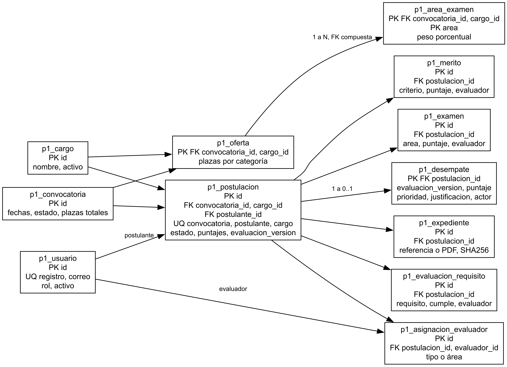
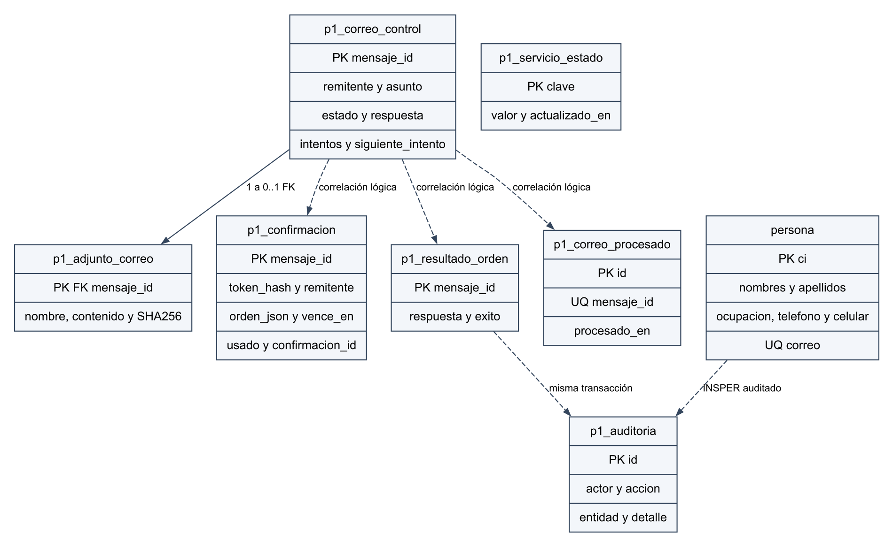

# INF513 Proyecto 1 Grupo 09 SA

Revisión vigente del 15 de noviembre: **122 pruebas aprobadas**. Se corrigió y reprodujo el [bloqueo del cupo por PDF vencidos](docs/CORRECCION_CUPO_PDF_VENCIDO.md). Las cifras inferiores siguientes son revisiones anteriores. El ensayo institucional de esta versión quedó pendiente por un fallo DNS del servidor de PostgreSQL.

Verificación de ataques del 15 de noviembre: **119 pruebas aprobadas**, incluidas 180 cargas en parámetros numéricos, SQL desde el asunto, permisos entre usuarios, confirmaciones concurrentes y URL interna. Véase [el informe de ataques](docs/PRUEBAS_ATAQUES_2026_11_15.md). No se modificó el código de producción; las cifras de 111 o inferiores siguientes corresponden a revisiones anteriores.

Revisión vigente: **111 pruebas aprobadas**, incluidas categorías, ponderación por áreas y desempates. Véase [el cierre de los ocho CU](docs/CIERRE_OCHO_CU.md); las cifras inferiores que siguen pertenecen a revisiones anteriores.

## Revisión para la entrega de noviembre de 2026

El alcance de esta primera parte comprende únicamente los ocho casos de uso aprobados: usuarios; convocatorias; postulación múltiple y expediente; requisitos y habilitación; méritos, examen y evaluadores; ranking y plazas; auditoría; reportes. Los 30 requisitos del foro no son 30 casos de uso ni amplían el alcance de esta entrega. Las operaciones y límites implementados están detallados en [la revisión del código](docs/REVISION_CODIGO.md).

Los controles OWASP, antivirus y ensayo de cuatro roles se explican en [CONTROLES_OWASP.md](docs/CONTROLES_OWASP.md). La revisión adversarial y sus siete correcciones están en [AUDITORIA_ADVERSARIAL.md](docs/AUDITORIA_ADVERSARIAL.md). La auditoría está documentada en [AUDITORIA_SEGURIDAD.md](docs/AUDITORIA_SEGURIDAD.md): 103 pruebas, OSV, SpotBugs con Find Security Bugs y Gitleaks. El [estado de despliegue](docs/ESTADO_DESPLIEGUE.md) registra respaldo restaurado, migración aplicada y servicio activo con correo real. El servidor PostgreSQL institucional no admite SSL; esta limitación requiere intervención de su administrador.

La [consigna oficial y su trazabilidad](docs/CONSIGNA_Y_TRAZABILIDAD.md) se verificaron en Presencial UAGRM. El [guion de defensa](docs/CAMBIOS_Y_DEFENSA.md) se complementa con el estado de despliegue actual; las referencias anteriores a migración pendiente corresponden a revisiones previas.

### Ejemplos exactos del docente

```text
LISPER["*"]
INSPER["4715292","Juan Carlos","Perez Seras","Estudiante","33554433","71055123","juanperez@uagrm.edu.bo"]
```

Son operaciones sobre `persona`, con campos `ci, nombres, apellidos, ocupacion, telefono, celular, correo`. Son públicas para reproducir el intercambio directo de la consigna y no crean roles del sistema de auxiliaturas. La inserción correcta responde `Éxito: Registro insertado correctamente`; una CI o correo duplicados producen un error y no otra fila.

### Cargar un expediente PDF real

El POSTULANTE envía el asunto siguiente y adjunta **un archivo PDF de hasta 2 MiB** al mismo correo:

```text
INSPOST["1","1","ADJUNTO"]
```

Debe sustituir los IDs por los de una convocatoria abierta y vigente y un cargo activo. El PDF se conserva en la cola durable junto al asunto. Después de responder con el `CONFIRMAR` recibido, el servicio crea la postulación y guarda los bytes, nombre y SHA-256 en `p1_expediente`. La cabecera `%PDF-`, el nombre y el tamaño se validan; el programa no ejecuta el PDF y exige análisis antivirus antes de almacenarlo: Defender en Windows o ClamAV en Linux. La extracción está implementada para Roundcube, IMAP y POP3; la suite de esta revisión verifica MIME y persistencia local, sin afirmar una nueva prueba contra el Roundcube institucional.

El tercer parámetro también puede seguir siendo una ruta o URL externa. En ese caso solo se guarda una **referencia**; el servicio no descarga ese enlace y la respuesta lo identifica expresamente.

### Archivos de actividad

El servicio crea `logs/access.log` y `logs/error.log` al iniciar. `LOG_DIR` o la propiedad Java `-Dapp.log.dir=...` permiten cambiar el directorio. Se registran fecha UTC, evento, ID, remitente, nombre del comando y resultado. Las excepciones registran clase y SQLSTATE, sin su mensaje crudo. No se guardan los parámetros ni códigos de confirmación. Se conserva el archivo activo y tres rotaciones de hasta 5 MiB; dé permisos de escritura únicamente al operador del servicio.

### Arquitectura


### Flujo del analizador de correos


La recepción guarda de forma durable antes de marcar leído. El analizador crea una `Orden` inmutable; `ProcesadorOrden` aplica catálogo, validación y permisos. El repositorio comparte negocio, auditoría y resultado en una transacción. La cola separa la ejecución del posterior envío de la respuesta. Una confirmación pendiente no representa un fallo de infraestructura.

### Esquema y relaciones



`p1_postulacion` une convocatoria, usuario postulante y cargo y evita duplicar esa combinación. Expedientes, requisitos, méritos, exámenes y asignaciones se vinculan por claves foráneas. `p1_asignacion_evaluador` vincula además al usuario evaluador. `p1_usuario` mantiene roles y estado; `persona` es el catálogo independiente del ejemplo docente.



`p1_correo_control` conserva recepción, diferimiento, respuesta pendiente e intentos. `p1_adjunto_correo` tiene una relación física de uno a cero o un PDF con esa cola. Confirmaciones, resultados e histórico se correlacionan por IDs; las líneas discontinuas del diagrama representan esa correlación lógica y no claves foráneas inexistentes. `p1_auditoria` conserva actor, acción y referencia; `p1_servicio_estado` identifica la inicialización de cada transporte.

La migración no borra datos ni reemplaza tablas: añade `persona`, `p1_adjunto_correo` y tres columnas opcionales a expedientes. Antes de aplicarla a una base compartida, compruebe si ya existe `persona` y que su estructura coincide. No aplique sobre esa tabla una migración destructiva para resolver incompatibilidades.

Sistema por correo electrónico para gestionar convocatorias de auxiliaturas. Incluye además los ejemplos literales LISPER e INSPER de la consigna, sobre la tabla persona. El servicio Java revisa la bandeja del grupo, interpreta la orden escrita en el asunto, valida permisos y parámetros, ejecuta la operación en PostgreSQL y responde al remitente.

## Integrantes

- 223045888 - Acosta Osorio Lin Fernanda - Ingeniería en Sistemas
- 223043982 - Ramos Vargas Brayan Joel - Ingeniería en Sistemas
- 213114976 - Rodriguez Aguilera Walter - Ingeniería en Sistemas

## Requisitos

- Java 17
- Maven 3.9 o superior
- PostgreSQL
- Cuenta de correo del grupo con Roundcube HTTPS para lectura y respuesta

## Construcción

```text
mvn clean test package
```

El JAR ejecutable queda en `target/inf513-proyecto1-1.0.0.jar`.

## Configuración segura

Copie `config/application.example.properties` como `config/application.properties`. Las contraseñas no deben escribirse en el repositorio; configure `MAIL_PASSWORD` y `DB_PASSWORD` como variables de entorno. Si la tabla `p1_usuario` todavía está vacía, defina también `BOOTSTRAP_ADMIN_EMAIL` con el correo exacto que enviará `INSUSU` para crear el primer DECANO. El valor deja de otorgar privilegios después de esa creación.

## Ejecución

```text
java -jar target/inf513-proyecto1-1.0.0.jar
```

Ejecución supervisada en Windows:

```powershell
.\scripts\run-service.ps1
```

Ejecución supervisada en Fedora/Linux:

```sh
chmod +x scripts/run-service.sh
./scripts/run-service.sh
```

Para un servidor Fedora se incluye `deploy/inf513-grupo09sa.service`, que reinicia el proceso mediante systemd.
Los scripts usan el JAR recién compilado de `target/` cuando existe y, dentro del paquete de entrega, recurren automáticamente al ejecutable incluido en `dist/`.

La configuración predeterminada utiliza Roundcube HTTPS tanto para leer como para responder, de modo que la contraseña no viaja por POP3 sin cifrar. POP3 continúa disponible únicamente como respaldo configurable. Si el docente habilita SMTP autenticado, puede seleccionarse con `MAIL_OUTBOUND_MODE=smtp`.

La orden completa debe escribirse en el asunto, por ejemplo `LISCON["*"]` o `AYUDA[]`.

Los comandos con datos privados o cambios de negocio requieren confirmar acceso a la cuenta de correo. Envíe la orden habitual; el sistema devuelve a esa dirección un código aleatorio y el asunto `CONFIRMAR["codigo"]` que debe enviar desde la misma cuenta. El código dura 30 minutos, autoriza exclusivamente la orden original y se consume junto con la operación en una transacción. `AYUDA`, `LISCON` y `LISCAR` permanecen públicos. Una cabecera `From` falsificada solo provoca una solicitud de confirmación al titular; no ejecuta la orden. El primer DECANO también requiere confirmación.

Para actualizar una instalación existente, detenga el proceso, aplique `database/schema.sql` mediante `AplicarEsquema` y arranque el JAR actualizado. Las migraciones conservan los datos existentes. La cola admite hasta 10.000 pendientes; la promoción respeta 60 órdenes por remitente y 1.000 globales por hora. Los excedentes esperan en la cola o en la bandeja sin marcarse como procesados. Tras una espera superior a la vigencia del código, vuelva a enviar la orden original para obtener un código nuevo.

## Seguridad

- Los comandos sensibles requieren demostrar acceso al correo y vuelven a verificar el rol al confirmar.
- Las escrituras principales utilizan consultas preparadas.
- En IMAP, los mensajes se marcan como leídos después de guardarlos de forma duradera en PostgreSQL; la cola persiste aunque falle el envío. Los excedentes sin guardar permanecen no leídos.
- Cada UIDL se ejecuta de manera idempotente: operación, auditoría y resultado comparten una transacción.
- Una respuesta que no pudo enviarse queda en una cola persistente y se reintenta sin repetir el cambio de negocio.
- PostgreSQL, POP3 y Roundcube tienen tiempos máximos y reintentos progresivos.
- Los asuntos y parámetros excesivos, los listados enormes y las ráfagas de mensajes están limitados.
- Las credenciales se mantienen fuera del código y de GitHub.
- Antes de producción se debe aplicar `database/schema.sql` y registrar las cuentas autorizadas.

Los códigos activos se almacenan como hash en `p1_confirmacion`; el correo pendiente de envío contiene necesariamente el código en su cuerpo. PostgreSQL y la cuenta institucional deben estar restringidos a operadores autorizados. No muestre códigos activos durante la defensa. El respaldo POP3 sin cifrar solo es apropiado para una red confiable porque transporta estos mensajes. La deduplicación de IMAP usa PostgreSQL como registro principal; las referencias del lote se liberan incluso si falla la lectura.

Pruebas con PostgreSQL desechable: defina `TEST_DB_URL`, `TEST_DB_USER` y `TEST_DB_PASSWORD` y ejecute `mvn clean verify`. La suite crea y elimina únicamente esquemas temporales propios, sin tocar las tablas del proyecto. GitHub Actions ejecuta estas pruebas automáticamente en PostgreSQL 15.

El plazo de confirmación se comprueba contra la hora en que el servicio registró el correo, no contra la hora posterior de ejecución. Una confirmación registrada dentro de los 30 minutos puede esperar diferida sin perder validez. Si no llegó a registrarse dentro del plazo, solicite un código nuevo.

## Recuperación ante fallos

El proceso no termina cuando PostgreSQL, POP3, Roundcube o Internet dejan de responder temporalmente. Conserva las respuestas pendientes en `p1_correo_control`, aumenta gradualmente el tiempo entre reintentos y continúa cuando el servicio vuelve. `p1_resultado_orden` impide ejecutar dos veces el mismo correo.

## Límite impuesto por la infraestructura institucional

El 12 de octubre de 2026 se comprobó que POP3 solo está disponible en el puerto 110 sin `STLS`, pero también se comprobó que Roundcube permite listar la bandeja mediante su sesión HTTPS. Por eso el modo predeterminado evita POP3 y cifra tanto la autenticación como la lectura. Si se fuerza `MAIL_INBOUND_PROTOCOL=pop3`, debe hacerse únicamente en una red confiable.

La [revisión detallada del código](docs/REVISION_CODIGO.md) contrasta los ocho casos, las observaciones y el proyecto de referencia. La auditoría de calificaciones conserva valores anteriores y posteriores; las notas y los reintentos concurrentes se serializan en PostgreSQL.
