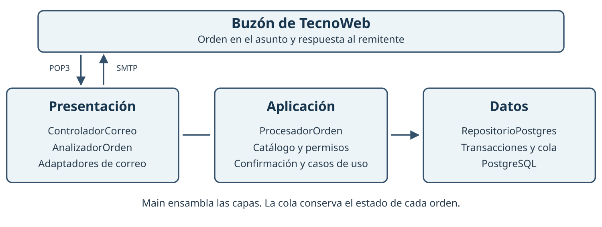
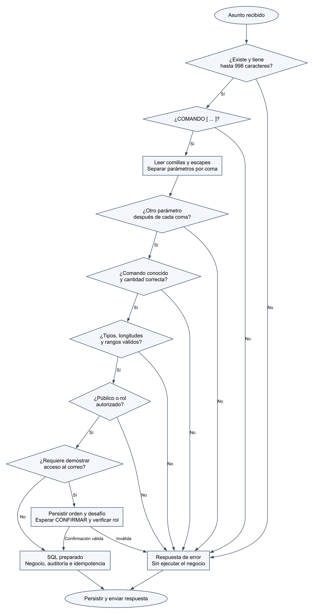

# INF513 Proyecto 1 Grupo 09 SA

Sistema de gestión de convocatorias de auxiliaturas por correo electrónico con Java 17 y PostgreSQL. El [PUDS](entrega/PUDS_INF513_P1_Grupo09SA.pdf) documenta los ocho casos de uso. La [guía de verificación](docs/revision-p1-tres-capas.md) reúne las pruebas de cada caso.

## Arquitectura y esquema



Presentación recibe y analiza el correo. Aplicación valida parámetros y roles y coordina el caso de uso. Datos aplica transacciones, mantiene la cola y ejecuta consultas preparadas en PostgreSQL. El [modelo de datos](docs/modelo-datos-p1-tres-capas.svg) muestra las 19 tablas y las 14 claves foráneas de una instalación limpia. La tabla `persona` sirve a los ejemplos del docente.

## Flujo del analizador



El servicio conserva el correo antes de marcarlo como leído. El analizador valida la sintaxis del asunto. El procesador comprueba los tipos y permisos, y las órdenes privadas requieren confirmación. La operación, su auditoría y el resultado se confirman en una sola transacción. La cola conserva la respuesta pendiente hasta que se pueda enviar.

## Ensayar en Fedora

Usá Java 17 o superior y Podman. Desde la raíz de esta carpeta:

```sh
bash scripts/ensayo-local.sh
```

El ensayo usa PostgreSQL local y una bandeja simulada. Escribí `AYUDA[]` en el indicador para ver las órdenes disponibles. El script muestra cómo se confirma la primera operación privada y cómo se rechaza un asunto inválido.

## Probar el código

Con un JDK 17 o superior y Maven, ejecutá `mvn clean test package`. Para habilitar la suite de PostgreSQL, configurá `TEST_DB_URL`, `TEST_DB_USER` y `TEST_DB_PASSWORD` para una base de ensayo. Si reutilizás el contenedor local, la URL es `jdbc:postgresql://127.0.0.1:55439/ensayo`, el usuario es `ensayo` y la contraseña local es `ensayo-local`.

`dist/inf513-proyecto1-1.0.0.jar` es el ejecutable completo. `dist/ensayo-local.jar` contiene el adaptador de correo simulado, cuyo código fuente está en `scripts/laboratorio`.

## Probar con el correo institucional

Copiá `config/application.example.properties` a `config/application.properties` y ajustá los hosts a los que indique la cátedra. Cargá `MAIL_PASSWORD` y `DB_PASSWORD` en el entorno privado antes de ejecutar `bash scripts/run-service.sh`. El perfil de ejemplo usa POP3, SMTP y PostgreSQL por loopback para una ejecución dentro del servidor que ofrece esos servicios. El host institucional publicado para PostgreSQL es `db.tecnoweb.org.bo` y la base asignada es `db_grupo09sa`. El código requiere cifrado para POP3 remoto. Roundcube HTTPS también está disponible para pruebas de buzón.

Las órdenes se escriben en el asunto de correos nuevos. Enviá `LISPER["*"]` para consultar `persona`. La inserción `INSPER` recibe siete parámetros en este orden: CI, nombres, apellidos, ocupación, teléfono, celular y correo. Usá datos ficticios y comprobá el rechazo al repetir el mismo CI. Para probar el analizador, enviá `LISPER[*]`. Las órdenes con rol solicitan un código que se confirma desde la misma cuenta.

Un problema transitorio de PostgreSQL se registra y se reintenta. La respuesta puede quedar demorada hasta que se recupere la base. Revisá `logs/access.log` y `logs/error.log` en el equipo que ejecuta el JAR.

En una instalación existente, ejecutá la migración en una copia y respaldá la base antes de arrancar una versión nueva. El nuevo JAR lee los históricos de `p1_correo_control` luego de aplicar `database/schema.sql`. El esquema conserva una tabla histórica antigua si ya existía para facilitar la reversión.


## Aplicar y comprobar el esquema

Con la configuración de la instalación en el entorno, ejecutá desde la raíz del proyecto:

```sh
java -cp dist/inf513-proyecto1-1.0.0.jar bo.edu.uagrm.inf513.grupo09sa.AplicarEsquema
java -cp dist/inf513-proyecto1-1.0.0.jar bo.edu.uagrm.inf513.grupo09sa.DiagnosticoIntegridad
```

El primer comando aplica el SQL completo en una transacción. El segundo comprueba las restricciones de la base seleccionada.
